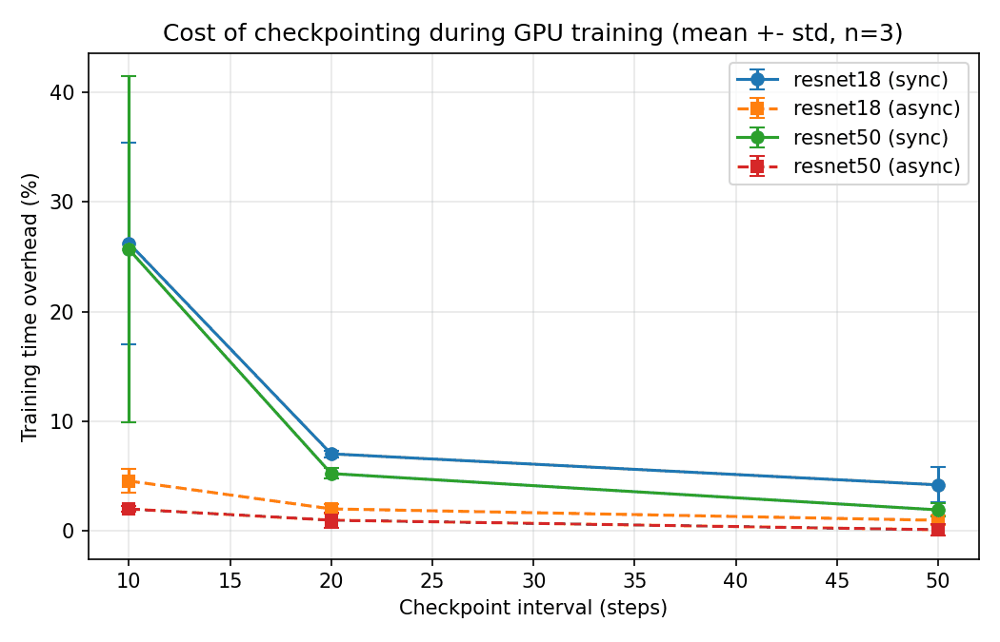

# Checkpoint Overhead Benchmark

Measuring how much periodic checkpointing slows down GPU training, and comparing synchronous vs. asynchronous checkpoint saving.

## Motivation

Long training jobs on large clusters can crash because of hardware failures, so they save checkpoints (model + optimizer state) regularly to be able to resume. Saving takes time though. I wanted to see how big this cost is in practice and whether saving in a background thread reduces it.

Two strategies are compared:

- **sync**: training stops until the checkpoint is written to disk.
- **async**: the state is copied to CPU memory first, then written to disk by a background thread while training continues.

## Setup

- GPU: NVIDIA Tesla T4 (Google Colab)
- Framework: PyTorch
- Models: ResNet-18 (~97 ms per step) and ResNet-50 (~322 ms per step)
- Data: random tensors (224x224, batch size 32), so data loading does not affect the measurement
- 200 training steps per run, each configuration repeated 3 times
- Checkpoint every 50, 20 and 10 steps
- Checkpoint size: ~90 MB (ResNet-18), ~189 MB (ResNet-50), including SGD momentum

Overhead = extra training time compared to a run without checkpointing (baseline measured in the same repeat).

## Results (mean ± std, 3 repeats)

Training time overhead:

| Model | Interval (steps) | Sync | Async |
|---|---|---|---|
| ResNet-18 | 50 | 4.18% ± 1.62 | 0.94% ± 0.42 |
| ResNet-18 | 20 | 7.01% ± 0.29 | 1.98% ± 0.43 |
| ResNet-18 | 10 | 26.25% ± 9.21 | 4.53% ± 1.11 |
| ResNet-50 | 50 | 1.89% ± 0.61 | 0.08% ± 0.56 |
| ResNet-50 | 20 | 5.21% ± 0.49 | 0.95% ± 0.66 |
| ResNet-50 | 10 | 25.67% ± 15.81 | 1.97% ± 0.28 |

Time training is blocked per checkpoint: about 0.15 s (sync) vs 0.04 s (async) for ResNet-18, and about 0.35 s (sync) vs 0.07 s (async) for ResNet-50.



Raw data: [`results/results_raw.csv`](results/results_raw.csv), summary: [`results/results_summary.csv`](results/results_summary.csv).

## Observations

1. **Async saving reduced overhead for both models at every interval.** At a 10-step interval, overhead dropped from ~26% to ~4.5% (ResNet-18) and from ~26% to ~2% (ResNet-50).

2. **Sync saving becomes unstable when checkpoints are frequent.** At a 10-step interval the standard deviation is very large (± 9 and ± 16 points). In one ResNet-50 run the overhead reached 43%, and the blocked time per checkpoint grew from ~0.35 s to ~1.4 s. My guess is that the storage cannot absorb writes this fast, so later writes have to wait for earlier ones to be flushed.

3. **Async has a hidden cost: write backlog.** For ResNet-18 at a 10-step interval, training finished on time, but in one run the background writes needed **27 extra seconds** to finish after training ended (2.9 s in another run, under 0.2 s in the rest). That interval produces roughly 90 MB of checkpoint data per second, which seems to be more than the disk could sustain. ResNet-50 at the same interval produces about 57 MB/s and never built a backlog (≤ 0.4 s). While a backlog exists, the newest checkpoints are not yet on disk, so a crash at that moment would lose more work than expected, and the queued snapshots also use CPU memory.

4. **A single run was misleading.** My first single-run test suggested async was slightly worse than sync for ResNet-18 at long intervals. With 3 repeats this did not hold: async was better in every configuration. The earlier result was within run-to-run noise.

**Takeaway:** async checkpointing hides most of the cost, but only as long as the checkpoint data rate stays below what the storage can write. Above that, the cost moves from "training is slower" to "checkpoints are late".

## GPT-2 small (large checkpoint)

To see what happens with a much bigger checkpoint, I repeated the test with GPT-2 small (124M parameters, random weights, batch size 8, sequence length 128, 200 steps, about 0.28 s per step), checkpointing every 50 steps. Checkpoint size is about 1 GB (model + SGD momentum). 3 repeats.

| Mode | Overhead during training | Blocked time per checkpoint | Time until all checkpoints are on disk, vs. no checkpointing |
|---|---|---|---|
| sync | 131.5% ± 63.0 (199%, 74%, 122%) | 18.7 s ± 7.8 | same as training time |
| async | 7.1% ± 4.8 (11.5%, 7.9%, 2.0%) | 0.57 s ± 0.27 | +275%, +203%, +24% |

Raw data: [`results/gpt2_results_raw.csv`](results/gpt2_results_raw.csv), [`results/gpt2_results_summary.csv`](results/gpt2_results_summary.csv).

What I see:

1. **Async hides almost all of the blocking.** Training itself was only 2-12% slower, compared with 74-199% for sync. Each synchronous save stopped training for 11-27 s, which is about 40-95 training steps' worth of time.

2. **But the writes did not keep up.** In runs 1 and 2 the background writer was still working 146 s and 115 s after training had ended (13 s in run 3). So the time until all four checkpoints were actually on disk was *longer* for async than for sync in two of the three runs (208 s vs 165 s, 178 s vs 102 s), and shorter only in run 3 (73 s vs 130 s). On average the two were similar (153 s vs 133 s). The "7% overhead" number only counts the training loop; it does not mean the checkpoints are safe.

3. **Disk speed varied a lot between runs.** Dividing the 996 MB sync checkpoint by its blocked time gives an effective write speed of 37, 90 and 55 MB/s in the three runs. This is why the sync overhead has such a large spread (± 63 points). I did not benchmark the disk separately, so I cannot say whether this comes from Colab's storage or something else.

4. **Possible bug in my async path.** The async checkpoint is 1150 MB while the sync one is 996 MB. The difference, 154 MB, is exactly the size of GPT-2's embedding matrix (50257 x 768 x 4 bytes). My guess is that GPT-2 shares this matrix between the input embedding and the output layer, `torch.save` stores it once, but my CPU copy breaks the sharing so it gets written twice. This means async wrote about 15% more data than sync here, which makes its backlog look slightly worse than it should. I have not tested this yet.

## Limitations

- One GPU and one local disk. Real HPC systems save from many nodes to parallel file systems, where bandwidth is shared.
- Synthetic data only.
- Only 3 repeats; the high-variance configurations (10-step ResNet, all GPT-2 sync runs) would need more.
- GPT-2 was only tested at a 50-step interval.
- The storage explanations above are hypotheses; I did not measure disk throughput directly.

## Next steps

- Measure the disk write bandwidth directly and check whether the backlog starts exactly when the checkpoint data rate exceeds it.
- Limit the async queue (e.g. skip or wait if the previous checkpoint is still being written) and measure the trade-off.
- Check the tied-embedding explanation for the larger async checkpoint (GPT-2) and fix the copy so both modes write the same amount of data.
- Try more intervals for GPT-2 and different storage (local disk vs. Google Drive / network storage).
- Save only part of the state (for example weights without optimizer buffers, or only the layers that changed, as in LLMTailor) and check whether smaller checkpoints avoid the backlog.

## Related work

This is a small single-GPU experiment. Two papers study the same problem at real scale:

- Xu et al., "An Efficient Checkpointing System for Large Machine Learning Model Training" (SC-W 2024). Checkpoints are first written to node-local storage and then moved to the shared file system asynchronously. The authors note that insufficient node-local memory can overflow and interrupt training, which is the large-scale version of the backlog I observed here.
- Sun et al., "LLMTailor: A Layer-wise Tailoring Tool for Efficient Checkpointing of Large Language Models" (PDSW 2025). Only the layers that changed significantly are checkpointed, which reduces checkpoint size and time.

## Running it

On Google Colab with a T4 GPU:

```bash
!python checkpoint_benchmark.py              # 3 repeats, about 35 min
!python checkpoint_benchmark.py --repeats 1  # quick run
!python checkpoint_benchmark.py --models gpt2 --intervals 50 --batch 8  # GPT-2, about 10 min
```

Output files: `results_raw.csv`, `results_summary.csv`, `overhead_plot.png`.

Code written with help from AI coding tools.

## Author

Sadeq Al-Hakeem, Automation and AI Engineering, Al-Nahrain University, Baghdad
